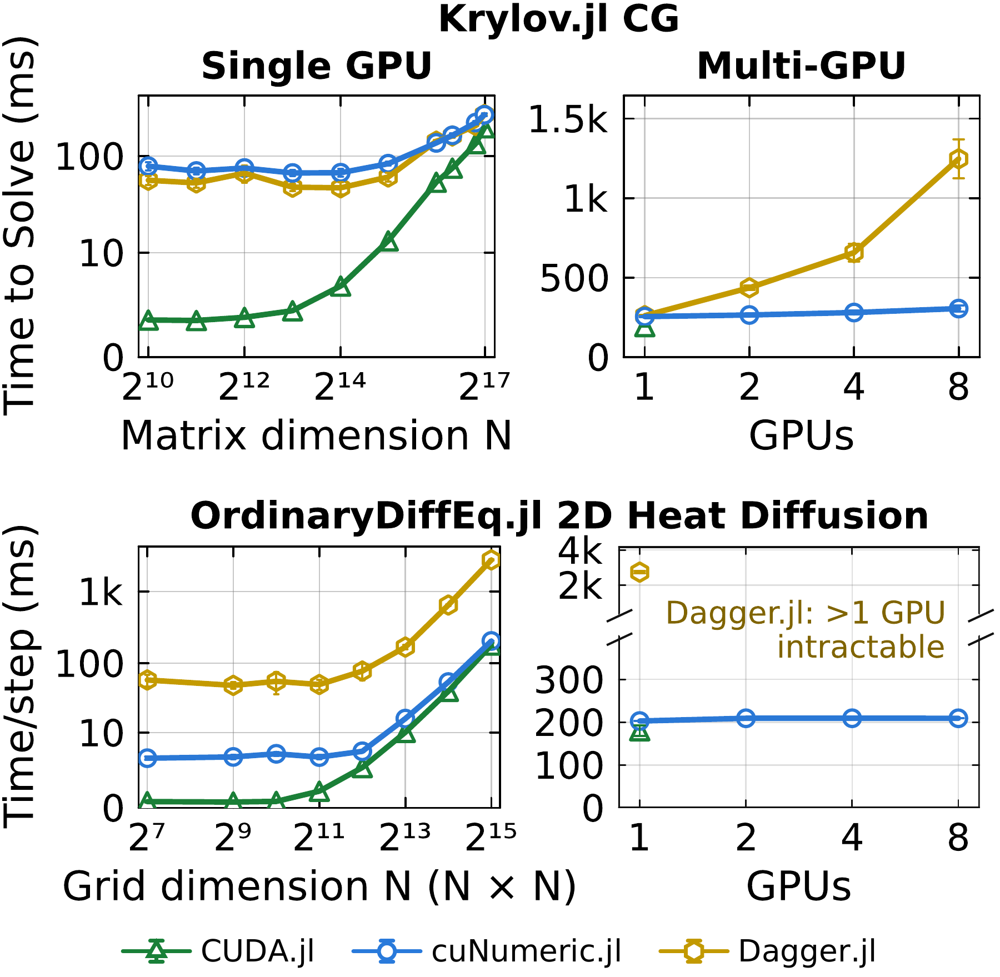

# Benchmarking

The code and configurations are in our [benchmarking repository](https://github.com/JuliaLegate/benchmarking). Run `./run_all.sh` from the repository root, or read its [README](https://github.com/JuliaLegate/benchmarking#readme) for setup and individual benchmarks.

## Package Integrations

The [Krylov.jl CG](../examples/krylov.md) and [OrdinaryDiffEq.jl heat diffusion](../examples/ordinarydiffeq.md) benchmarks compare cuNumeric.jl, CUDA.jl, and Dagger.jl arrays. The left panels vary the problem size on one GPU. The right panels show weak scaling, where cuNumeric.jl keeps solve and step times nearly constant as the GPU count grows.

Lower times are better. Click the figure to open the PDF.

## cuNumeric Kernels and Applications

Results for kernels and applications written entirely with cuNumeric are coming soon!
