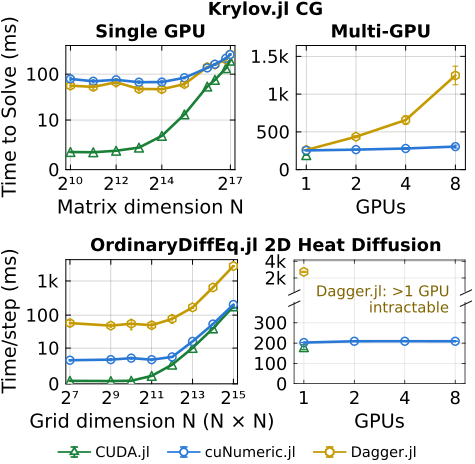
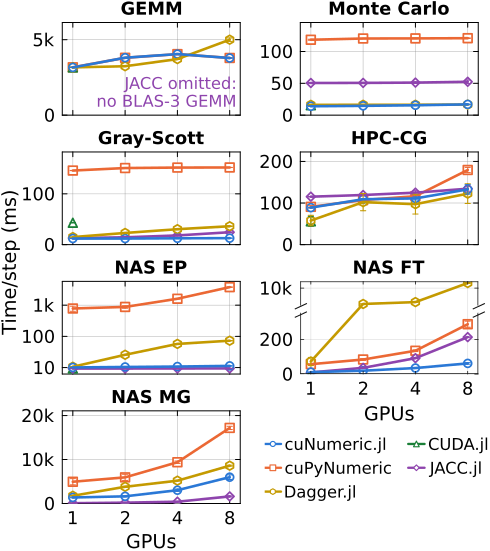
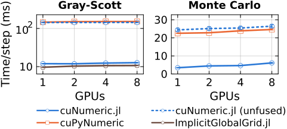
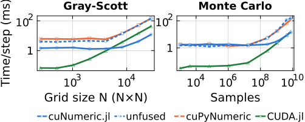
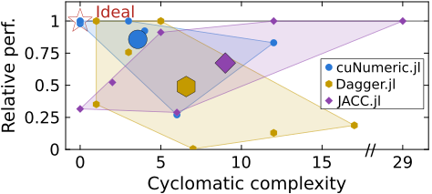

# Benchmarking

The code and configurations are in our [benchmarking repository](https://github.com/JuliaLegate/benchmarking). Run `./run_all.sh` from the repository root, or read its [README](https://github.com/JuliaLegate/benchmarking#readme) for setup and individual benchmarks.

## Running the Benchmarks

The benchmarks are not part of the registered package. Fetch them into `benchmark/` (git-ignored) from a cuNumeric.jl checkout:

```bash
git clone https://github.com/JuliaLegate/cuNumeric.jl && cd cuNumeric.jl
./scripts/get_benchmarks.sh            # latest
./scripts/get_benchmarks.sh <git ref>  # or a specific tag/commit, e.g. the one used for a paper
```

Then run a quick smoke pass or the full suite:

```bash
cd benchmark
./run_smoke.sh   # small sizes, results/smoke/
./run_all.sh     # full sizes, results/paper/
./plot_all.sh
```

Re-running `get_benchmarks.sh` updates an existing checkout.

## Package Integrations

The [Krylov.jl CG](../examples/krylov.md) and [OrdinaryDiffEq.jl heat diffusion](../examples/ordinarydiffeq.md) benchmarks compare cuNumeric.jl, [CUDA.jl](https://github.com/JuliaGPU/CUDA.jl), and [Dagger.jl](https://github.com/JuliaParallel/Dagger.jl) arrays. The left panels vary the problem size on one GPU. The right panels show weak scaling, where cuNumeric.jl keeps solve and step times nearly constant as the GPU count grows.

Lower times are better.



## cuNumeric Kernels and Applications

These benchmarks are written entirely with cuNumeric.jl and compared against [cuPyNumeric](https://github.com/nv-legate/cupynumeric) and other Julia GPU frameworks. Lower times are better.

### Weak Scaling

Time per step on 1–8 GPUs for GEMM, [Monte Carlo](../examples/montecarlo.md), [Gray-Scott](../examples/grayscott.md), [HPC-CG](../examples/cg.md), and NAS EP, FT, and MG, compared with cuPyNumeric, CUDA.jl, Dagger.jl, and [JACC.jl](https://github.com/JuliaORNL/JACC.jl).



### Broadcast Fusion

[Gray-Scott](../examples/grayscott.md) and [Monte Carlo](../examples/montecarlo.md) with and without broadcast fusion, compared with cuPyNumeric and [ImplicitGlobalGrid.jl](https://github.com/eth-cscs/ImplicitGlobalGrid.jl).



### Problem Size Sweep

Time per step on one GPU as the problem size grows, for [Gray-Scott](../examples/grayscott.md) and [Monte Carlo](../examples/montecarlo.md). At small sizes, fixed per-task runtime overhead dominates and hand-written CUDA.jl kernels are faster. The gap closes as the problem grows.



### Code Complexity vs Performance

Cyclomatic complexity of each implementation against its performance relative to the fastest model on 8 GPUs. Small markers are individual benchmarks and large markers are per-model means. The ideal is the top-left corner.


