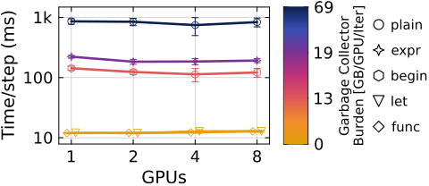

# `@accelerate`

`@accelerate` rewrites straight-line array code to:

1. **Fuse across statements.** A temporary used once is folded into the
   statement that consumes it, so on a GPU the chain runs as one kernel.
2. **Free temporaries early.** Temporaries that can't be fused are freed right
   after their last use, instead of waiting for Julia's GC. This works on CPU
   too.

```julia
@accelerate function update!(C, A, B)
    tmp = @. A + B
    C .= @. 2.0f0 * tmp     # runs as C .= @. 2.0f0 * (A + B)
    return C
end
```

Arguments and returned values are never freed. Loops, conditionals, `try`,
`&&`/`||` and nested functions are rejected: put `@accelerate` on the function
called in the loop, not around the loop.

## Forms

| Form | What stays valid afterwards |
|:---|:---|
| `@accelerate function ... end` (recommended) | arguments and the returned value |
| `@accelerate let ... end` | the result only |
| `@accelerate begin ... end` | every named variable |
| `@accelerate expr` | the result |

```julia
result = @accelerate let
    product = @. A * B
    @. product + 1
end

result = @accelerate (@. A + B * C)
```

With `begin`, each named result is kept, but a chain of same-shape statements
can still run as one GPU kernel that writes all of them.

The form also affects how much memory is left for Julia's garbage collector to reclaim. In this Gray-Scott benchmark, the `function` and `let` forms have the lowest step times and leave no temporary arrays for the GC. The colors show the amount of memory left to the GC per GPU per step. `plain` is the version without `@accelerate`.



## Writing the body

- Put `@.` on each right-hand side, not on the whole body, which would turn
  `x = ...` into `x .= ...`.
- Use `=` for a throwaway temporary, so it can be fused away.
- Use `.=` when the write must happen, for example into an argument. A
  preallocated `tmp .= ...` is kept, not fused.
- Calls to other functions run in order and are not fused through.
  Annotate those functions separately if they should be accelerated too.

[`@show_lifetimes`](../debugging.md#inspect-lifetime-rewrites-with-show_lifetimes)
prints the rewritten code without running it.

## Aggressive fusion and adaptive offsets

`@accelerate` (with the default `aggressive=true`) can merge independent adjacent
in-place updates into one kernel. It also permits adaptive element-offset
arithmetic for eligible GPU broadcasts of ranks 1–6, including single-output and
chained broadcasts. `@accelerate aggressive=false` and ordinary broadcasts use
64-bit offsets.

An adaptive signature compiles both 32-bit and 64-bit variants once. Each GPU
task checks its local dimensions and strides while packing array descriptors,
then launches the 32-bit variant only when the conservative absolute-offset
bound fits. Pointers, descriptors, traversal counters and coordinate decoding
remain 64-bit. Array sizes, layouts and scalar values do not specialize the PTX
cache, and struct-array signatures stay wide-only.

The policy applies to broadcasts written inside the macro; ordinary function
calls do not inherit it. CPU execution and unsupported broadcasts keep their
existing behavior. Adaptive GPU execution requires a wrapper build exposing
`RUN_PTX_BROADCAST_ADAPTIVE`; an older wrapper reports a rebuild/update error.
